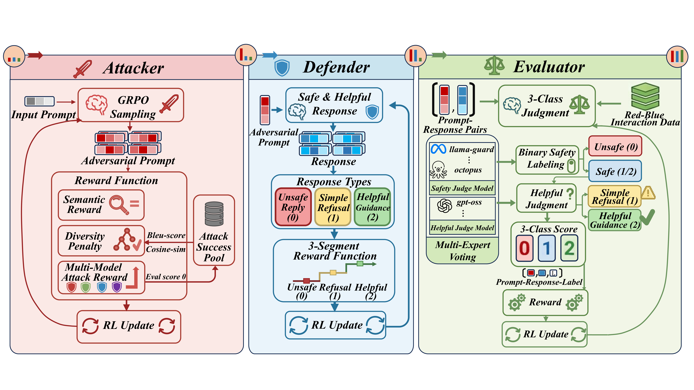
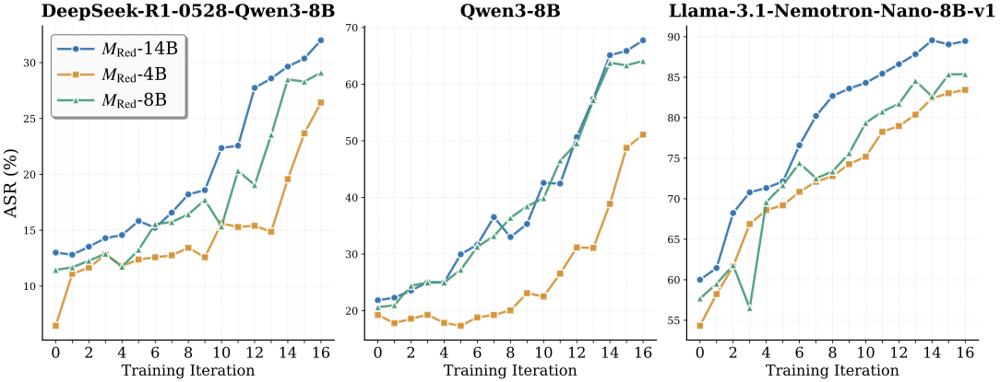
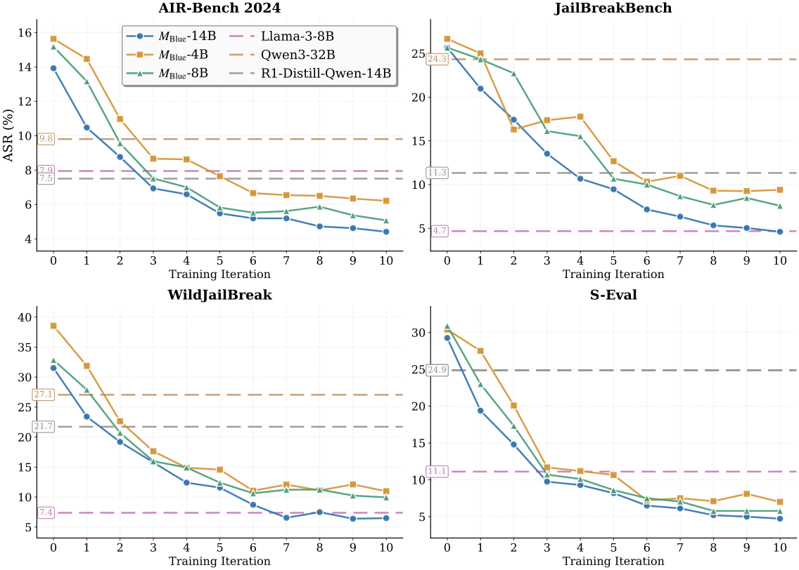
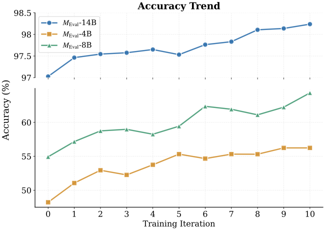

# 🔺 TriPlay-RL: Tri-Role Self-Play Reinforcement Learning for LLM Safety Alignment

**A Closed-Loop Reinforcement Learning Framework for Continuous Co-Evolution of Attacker, Defender, and Evaluator**

> This repository contains the official implementation of TriPlay-RL, a unified tri-role reinforcement learning framework that enables iterative and co-improving collaboration among three roles with near-zero manual annotation.

---

## 🚀 Quick Start

### Computing Infrastructure

| Component | Specification |
|-----------|---------------|
| GPU | 8× NVIDIA H800 |
| GPU memory | 81,559 MiB per GPU |
| NVIDIA-SMI | 550.54.15 |
| Driver | 550.54.15 |
| CUDA | 12.4 |

### Installation

```bash
# Clone the repository
git clone <repository-url>
cd TriPlay-RL

# Create and activate the conda environment
conda create -n triplay python==3.10 -y
conda activate triplay

# Install the required Python packages
pip install -r requirements.txt

# Install the local TRL fork
cd source_code/trl
pip install -e .
cd ../..
```

### Model Preparation

Before launching training, download or prepare the required models under the paths expected by the scripts. By default, the Qwen3-8B training loop expects:

```text
models/qwen/Qwen3-8B
models/qwen/Qwen3-14B
models/qwen/Qwen3-32B
models/glm/glm-4-9b
models/llama3/Meta-Llama-3.1-8B-Instruct
models/all-MiniLM-L6-v2
models/gpt-oss-safeguard-20b
models/octopus-seval-14B
models/llama3guard
models/qwen/Qwen2.5-32B
models/qwen/QwQ-32B
models/open-ai/gpt-oss-20b
models/qwen/QwQ-32B
models/qwen/Qwen3-30B-A3B-Thinking-2507
```

If your local model directories are different, update the model paths in:

```text
scripts_qwen3_8b/train_loop.py
eval.py
```

In `train_loop.py`, the most important fields are `last_model_path` for the initial Red/Blue/Eval models and `model_paths_config` for fixed reward or judge model overrides.

In `eval.py`, you can also directly change evaluator model paths in:
- `safety_models` (e.g. GPT-OSS Safeguard, SEval, Llama Guard)
- `helpful_models` (e.g. Qwen/QwQ/GPT-OSS helpfulness evaluators)

### Run Training Loop

```bash
python scripts_qwen3_8b/train_loop.py <begin_iteration> <max_iteration>
```

**Example:**
```bash
python scripts_qwen3_8b/train_loop.py 1 100
```

The first argument is the starting iteration. The second argument is the final/max iteration. For example, `1 100` runs the loop from iteration 1 through iteration 100.

Each full tri-role co-evolution iteration consists of:
1. Red mode training
2. QA-positive mode training
3. Eval mode training

The number of training steps for each role is controlled by `steps_config` in `scripts_qwen3_8b/train_loop.py`.


## 🧩 Framework Architecture


### Figure: Training Loop Internal Mechanism



---


## 📊 Experimental Results

### Red Result



- **90% ASR** against Llama-3.1-Nemotron-Nano-8B-v1
- **3x improvement** over baseline ASR against Qwen3-8B
- **20%–50% improvement** in adversarial effectiveness while preserving diversity

### QA / Blue Result



- **10%–30% gains** in safety performance
- Maintains general reasoning capability (no degradation)
- Effectively breaks the safety-utility trade-off

### Eval Result



- Fine-grained P/S/R classification accuracy
- Improved judgment consistency
- Strong resistance to reward hacking


---


## 📖 Citation

If you use TriPlay-RL in your research, please cite:

```bibtex
@article{tan2026triplay,
  title={TriPlay-RL: Tri-Role Self-Play Reinforcement Learning for LLM Safety Alignment},
  author={Tan, Zhewen and Yu, Wenhan and Si, Jianfeng and Liu, Tongxin and Guan, Kaiqi and Jin, Huiyan and Tao, Jiawen and Yuan, Xiaokun and Ma, Duohe and Zhang, Xiangzheng and others},
  journal={arXiv preprint arXiv:2601.18292},
  year={2026}
}
```

