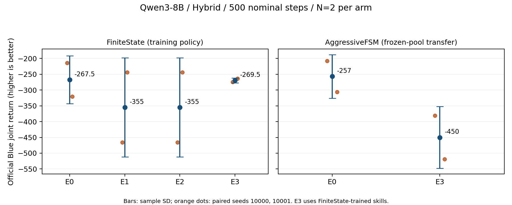
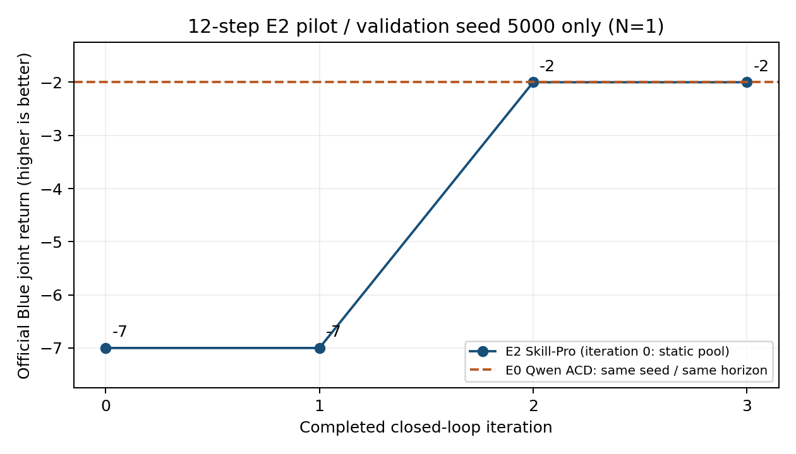

# Qwen ACD–Proposed 성능 비교와 closed-loop 진단

이 문서는 수정 전 실행의 보존된 분석이다. 출판 논문에 맞춘 수정은 [Skill-Pro 수정 보고서](skillpro_paper_fix.md), 2026-11-21 행동 분석·공정한 이력 대조·새 closed-loop 실험은 [행동 Skill 보완 보고서](behavior_skill_optimization.md)를 참고한다.

분석일: 2026-11-20 (Asia/Seoul). **이 보존된 실행 당시에는 Proposed의 기존 ACD 대비 성능 개선을 확인하지 못했다.** FiniteState에서 E3−E0 평균 차이는 −2.0이며, 학습하지 않은 AggressiveFSM에서는 −193.0이다. E3가 E2보다 +85.5 높은 결과와 E3가 기존 ACD보다 우수하다는 주장은 구분해야 한다.

기존 실제 Qwen/CAGE4 장기 평가 12 episodes를 원시 행동 로그에서 다시 집계했다. 이번 분석에서 12-step·동일 검증 시드의 E0/E1 대조 평가를 각각 1회 추가했다. 아래 수치는 mock, 논문 참고 수치, 다른 모델 결과를 포함하지 않는다. 원래 성능 로그와 정책 코드는 수정하지 않았다.

## 비교 조건과 지표

- 모델: `Qwen/Qwen3-8B`, BF16, 가중치 고정, revision `b968826d9c46dd6066d109eabc6255188de91218`. 학습 대상은 외부 Skill Pool이다.
- 구성: **Hybrid = 고정 KEEP 4명 + Qwen Blue agent 4 한 명**. 모든 Blue가 Qwen인 실험의 장기 성능은 아직 측정하지 않았다.
- 공통 프로토콜: `controlled-comparison`, `paper_projected_keep` 통신, 원본 CAGE4 보상·공식 terminal 제외 규칙. 무수정 ACD 논문 수치 재현과 구분한다.
- 장기 평가: nominal 500-step, 실제 공동 전이 499회, 점수 합산 498회/episode. Blue 5명에게 같은 공동 보상이 반환돼도 tick당 한 번만 더한다.
- 지표: 누적 Blue Joint Reward. **높을수록 좋다. −200이 −300보다 좋은 성능이다.** 표의 ±는 표본 표준편차이며 신뢰구간이 아니다.
- 장기 훈련: E2/E3 각각 seeds 100, 101의 2 episodes와 진화 1회, 후보 2개. 검증 seed 5000, 최종 평가 seeds 10000, 10001. 평가 중 Pool은 동결했다.

| Arm | 동작 |
|---|---|
| E0 | 기존 ACD + Qwen, Skill 없음 |
| E1 | ACD + Qwen + 초기 정적 Security Skills |
| E2 | E1 + Skill-Pro 최적화, CAGE4 전용 관측 검증 없음 |
| E3 | Proposed: E2 + CAGE4 전용 관측 검증 |

## 500-step 최종 평가

| Red | Arm | seed 10000 | seed 10001 | 평균 ± 표본 SD | E0 대비 평균 차이 |
|---|---|---:|---:|---:|---:|
| FiniteState | E0 ACD | −214 | −321 | **−267.5 ± 75.66** | 기준 |
| FiniteState | E1 정적 Skill | −466 | −244 | −355.0 ± 156.98 | −87.5 |
| FiniteState | E2 Skill-Pro | −466 | −244 | −355.0 ± 156.98 | −87.5 |
| FiniteState | E3 Proposed | −275 | −264 | **−269.5 ± 7.78** | **−2.0** |
| AggressiveFSM 전이 | E0 ACD | −208 | −306 | **−257.0 ± 69.30** | 기준 |
| AggressiveFSM 전이 | E3 Proposed | −381 | −519 | **−450.0 ± 97.58** | **−193.0** |

FiniteState에서 E3−E0의 대응 seed 차이는 [−61, +57]이다. 한 seed에서는 낮고 다른 seed에서는 높으므로, 두 표본만으로 우열이나 안정성을 확정할 수 없다. E3−E2는 [+191, −20], 평균 +85.5다. 정적 Skill 대비 회복이 최종 Baseline 초과 성능으로 이어지지는 않았다.

AggressiveFSM에서는 FiniteState에서 훈련한 E3 Pool을 그대로 고정했다. 추가 학습은 없었다. E3−E0 차이는 [−173, −213]으로 두 seed 모두 악화됐다. E1/E2의 AggressiveFSM 평가는 미실행이다.



## Closed-loop별 수치

### 장기 실험: 500-step

| Arm / loop | 훈련 seed별 보상 | 훈련 평균 | EMA baseline | 갱신 후 검증: seed 5000 | Pool | 승인 Skill | 최종 평가 평균: seeds 10000/10001 |
|---|---|---:|---:|---:|---|---|---:|
| E2 / 1 | 100: −209, 101: −560 | −384.5 | −384.5 | −296 | 7 → 7 | 없음 | −355.0 |
| E3 / 1 | 100: −329, 101: −167 | −248.0 | −248.0 | −156 | 7 → 8 | HostRecovery_v2 | −269.5 |
| E2/E3 / 2 이후 | 미실행 | N/A | N/A | N/A | N/A | N/A | N/A |

검증 seed 5000과 최종 평가 seeds 10000/10001은 다르다. E3 검증 −156을 E0의 최종 평가 평균 −267.5와 비교해 개선이라고 해석할 수 없다. **500-step E3의 반복 개선 곡선은 아직 없다.**

### 반복 실행·재개 예비 실험: 12-step E2

아래는 **CAGE4 전용 검증이 없는 E2**이며, 500-step E3와 다른 실험이다. 실제 공동 전이 11회/점수 전이 10회다. 각 loop 뒤 동일한 검증 seed 5000을 사용했다. 초기 정적 Pool과 Baseline은 이번 분석에서 같은 조건으로 추가 측정했다.

| E2 loop | 훈련 seeds | 훈련 보상 | 훈련 평균 | EMA baseline | 검증 보상 | Pool | 승인 Skill |
|---|---|---|---:|---:|---:|---|---|
| 0: 초기 정적 Pool | — | — | — | — | **−7** | 7 | — |
| 1 | 100, 101 | 0, 0 | 0.0 | 0.000 | **−7** | 7 → 7 | 없음 |
| 2 | 102, 103 | 0, −3 | −1.5 | −0.150 | **−2** | 7 → 8 | NetworkContainment_v2 |
| 3: checkpoint 재개 | 104, 105 | −5, −1 | −3.0 | −0.435 | **−2** | 8 → 8 | 없음 |
| E0 ACD 대조 | — | — | — | — | **−2** | Skill 없음 | — |

검증 결과는 −7 → −7 → −2 → −2로 초기 Skill 대비 5점 회복했으며, 같은 Qwen ACD와는 동률이다. 훈련 seed는 매 loop 바뀌므로 훈련 평균 자체를 동일 문제의 성능 곡선으로 해석하지 않는다. 검증도 단일 seed이며, 이 짧은 실험은 전체 500-step의 세 mission phase 성능을 검증하지 않는다. 재개한 summary에 들어 있는 loop 1/2 이력은 중복 집계하지 않았다.



### 별도 수식 점검: 20-step E2 / paper RTG

훈련 seeds 100, 101 보상 −2, −11, 평균 −6.5, EMA baseline −5.304184. loop 1 후 검증 −4. 후보는 둘 다 거부됐고, `paper_score` 유지 규칙이 비양수 점수의 NetworkContainment를 제거해 Pool은 7 → 6이 됐다. 이는 별도 RTG/maintenance 프로토콜이다. −4를 12-step 또는 500-step 점수와 직접 비교하지 않는다.

### 실제 후보 승인 기록

Gate 점수는 보상 단위가 아니다. `유효 행동 수`는 과거 궤적에서 확률 비교에 사용한 정책 결정 수이며, 새 후보로 실제 환경을 실행한 횟수가 아니다.

| 실험 / loop | 최적화 Parent | 후보 Gate scores | Gate 유효 행동 수 | 승인 |
|---|---|---|---:|---|
| 500-step E2 / 1 | TrafficRecovery | −1.620208, −1.928029 | 28 | 없음 |
| 500-step E3 / 1 | HostRecovery | +1.245279, +0.617210 | **4** | 첫 번째 후보 |
| 12-step E2 / 1 | NetworkContainment | 0, 0 | 6 | 없음 |
| 12-step E2 / 2 | NetworkContainment | +0.020457, +0.022426 | 6 | 두 번째 후보 |
| 12-step E2 / 3 | HostInvestigation | −4.148697, −4.348715 | **1** | 없음 |
| 20-step E2 RTG / 1 | NetworkContainment | −1.311303, −1.304460 | 20 | 없음 |

이 여섯 loop에서 기록된 진화 오류는 없다. 후보 거부와 시스템 오류를 구분한다.

## 성능이 개선되지 않은 이유

### 1. E2에서는 장기 평가 정책이 실제로 바뀌지 않았다

500-step E2가 생성한 두 후보는 음수 Gate 점수로 모두 거부됐다. 유지되는 7개 Skill의 정책 문구도 초기 Pool과 같았다. E1/E2의 평가 로그 **998개 공동 tick, Blue 행동 기록 4,990개**에서 관측·응답·행동·통신·보상이 모두 일치했다. E2−E1=0은 최적화가 평가 정책을 바꾸지 못한 결과다. [기존 독립 대조 기록](../research_outputs/real-500/skill_rejection_parity.json)과 이번 분석기의 재검사가 일치한다.

### 2. 첫 진화에서 중요한 고빈도 Skill이 뒤로 밀렸다

[고정 원본의 get_priority](../third_party/Skill-Pro/Skills/skill_evolution.py)는 빈도 15 미만이면 0을 반환하고, 이후 `t − last_evolved_iter < 3`이면 −0.01을 반환한다. 초기 Skill의 `last_evolved_iter=0`이므로 loop 1에서는 한 번도 진화하지 않은 고빈도 Skill에도 쿨다운이 적용된다. [연구 진화기](../research/evolution.py)는 준비된 Skill을 점수 내림차순으로 정렬해 이번 설정의 `max_evolutions=1`개를 고른다. 따라서 0점의 저빈도 Skill이 −0.01의 고빈도 Skill보다 먼저 선택됐다.

| Arm | Skill | 실제 활성화 빈도 | 진화 우선순위 | 실제 선택 |
|---|---|---:|---:|---|
| E2 | HostInvestigation | 19 | −0.01 | 아니오 |
| E2 | NetworkContainment | 61 | −0.01 | 아니오 |
| E2 | TrafficRecovery | 4 | 0.00 | **예** |
| E3 | HostInvestigation | 84 | −0.01 | 아니오 |
| E3 | ThreatRemoval | 34 | −0.01 | 아니오 |
| E3 | HostRecovery | 4 | 0.00 | **예** |

여기서 빈도는 Skill 활성화 횟수이고 Gate 행동 수와 다르다. 학습 예산이 한 loop뿐이라 이러한 초기 순위가 최적화 대상 전체를 결정했다. 이는 코드와 실제 체크포인트에서 확인된 현상이며 보상 감소량까지 입증한 것은 아니다. 원본 `run.py:44`는 `warm_up_flag=False`이므로 “활성화된 원본 5회 warmup을 제거했기 때문”이라는 설명은 사용하지 않는다. 기존 감사 문서의 warmup 설명도 이 사실에 맞춰 수정했다.

### 3. 승인한 E3 Skill의 평가 사용 비중이 너무 작다

유일한 새 Skill인 HostRecovery_v2의 실제 정책 사용은 FiniteState **5/754회 = 0.66%**, AggressiveFSM **5/770회 = 0.65%**다. FiniteState의 5회는 모두 seed 10001에 있다. 수정된 문구가 평가 결정의 대부분에 적용되지 않았으므로 한 번의 승인만으로 광범위한 개선을 기대할 근거가 약하다.

E3는 Skill 후보 필터와 종료 규칙도 함께 변경한다. **초기 Pool 그대로 검증기만 켠 E3 대조군이 없어**, E3−E2의 +85.5를 학습된 문구의 효과로 분리할 수 없다.

### 4. 반복 행동 검증이 정상 대기까지 포함할 수 있다

[CAGEVerifier.check](../research/skills.py)는 직전 두 요청과 그때의 관측 hash를 비교한다. 두 요청이 busy로 인해 정책 호출을 건너뛴 `Sleep`인지 구분하지 않으며, 현재 시점에 새 관측이 생겼는지도 이 분기에서 비교하지 않는다.

| E3 평가 | 반복 행동으로 종료 | 그중 Sleep 반복 | 직전 두 정책 호출 모두 생략 | 현재 관측 hash는 이미 변경 | 직전 행동이 방금 완료 |
|---|---:|---:|---:|---:|---:|
| FiniteState | 79 | **79** | 11 | 34 | 11 |
| AggressiveFSM | 109 | **109** | 8 | 32 | 8 |

오른쪽 세 열은 서로 겹칠 수 있다. 모든 종료가 오탐이라는 뜻은 아니지만, 정상 대기·완료와 잘못된 반복을 구분하지 않는 조건이 확인됐다. 종료 후 재선택이 발생해 유용한 절차가 끊길 수 있다. 이 요인으로 잃은 보상은 별도 검증기 ablation 없이는 수치화할 수 없다.

### 5. 행동과 대상의 출력 계약이 불완전하다

다음 비율의 분모는 실제 Qwen 정책 호출 수다. busy tick의 자동 Sleep은 분모에서 제외했다. 기존 결과 필드 `invalid_json`은 이름과 달리 대상·행동 오류도 함께 센다. **이 평가들의 JSON 문법 오류는 0건**이었다.

| Red / Arm | 정책 결정 | 파싱·대상·행동 오류 | 비율 | 알 수 없는 subnet | 잘못된 host | Skill 이름을 행동으로 출력 |
|---|---:|---:|---:|---:|---:|---:|
| FiniteState / E0 | 723 | 59 | 8.16% | 34 | 24 | 0 |
| FiniteState / E1 또는 E2 | 862 | 84 | 9.74% | 73 | 11 | 0 |
| FiniteState / E3 | 754 | 35 | 4.64% | 11 | 7 | **17** |
| AggressiveFSM / E0 | 814 | 42 | 5.16% | 27 | 14 | 0 |
| AggressiveFSM / E3 | 770 | 33 | 4.29% | 9 | 9 | **15** |

E0에는 각 정책에서 `host:` 누락 등 추가 행동 형식 오류가 1건씩 있다. E3는 `{"action":"WaitVerification", ...}`를 출력했다. 이것은 Skill 이름이고 CAGE4 실행 행동은 아니어서 원본 parser에서 거부 후 Sleep으로 대체됐다. 적절한 대기가 필요한 상황에서는 Sleep이 맞을 수 있으므로 이 32건 전체를 보상 손실로 환산하지 않는다.

그 밖에 `subnet:admin_network`, `subnet:10.0.54.0/24`는 parser가 요구하는 `admin_network_subnet` 같은 정식 ID와 다르다. 담당 밖의 host 선택도 있었다. [adapter.make_state/messages_for](../research/adapter.py)는 허용 host/subnet 목록을 계산해 parser에 전달하지만, 정책 prompt에 명시적인 정식 대상 목록을 넣지는 않는다. 기본 prompt의 zone 별칭·예시와 실제 parser 계약 사이에 혼동 여지가 있다.

E3의 전체 오류율은 E0보다 낮다. 따라서 “E3의 더 많은 JSON 실패 때문에 전이 성능이 하락했다”는 설명은 이 로그와 맞지 않는다. 정책 출력이 max_tokens=192에 도달한 경우도 0건이므로 토큰 잘림을 주원인으로 지목할 근거가 없다.

### 6. 양수 Gate는 환경 보상 개선을 보장하지 않는다

[현재 공개 코드 모드 Gate](../research/gate.py)는 episode 공동 보상과 EMA의 차이를 해당 Skill의 유효 행동 수로 나눈 advantage를 사용한다. KEEP 네 명의 영향이 포함된 공동 보상이며 특정 Skill의 인과적 기여를 분리하지 않는다. 비교 대상은 행동과 reason을 포함한 과거 JSON completion의 합산 token logprob에서 만든 비율이다. 새 후보가 선택할 미래 행동의 환경 보상은 직접 측정하지 않는다.

| 12-step E2 loop | 같은 증거에서 Parent 자기 점수 | 최상 후보 Gate | 후보−Parent | 원본 기준 승인 |
|---|---:|---:|---:|---|
| 2 | +0.025000 | +0.022426 | **−0.002574** | 예: 후보 > 0 |
| 3 | −4.565000 | −4.148697 | **+0.416303** | 아니오: 후보 < 0 |

loop 2는 seed 101의 과거 행동 6개만 검증 증거로 선택됐다. 양수라는 이유로 채택했지만 동일 proxy에서 Parent 자기 점수보다 낮았다. loop 3은 반대 방향이다. 이는 공개 코드의 절대 점수 승인 조건을 그대로 적용한 결과다. 검증 rollout은 승인 뒤 별도로 수행하지만 그 보상으로 승인을 취소하는 절차는 없다. 원본 방식과 달라지는 상대 Gate/환경 검증 Gate는 별도 실험으로 평가해야 한다.

실제 Gate의 생성·teacher-forcing 점수는 [32개 결정의 대조 기록](../research_outputs/real-500/gate_policy_parity.json)에서 최대 절대 차이 약 7.15×10⁻⁷이었다. 모델 오류로 후보를 승인한 기록도 없다. 현재 부진을 API fallback이나 확인되지 않은 로그확률 계산 실패로 설명하지 않는다.

### 7. 전이 손실은 여러 phase에서 발생했다

아래는 행동 **전** 관측 `mission_phase` 기준으로 공동 보상을 한 번씩 합산한 episode 평균이다. 세 열의 합은 최종 평균과 같다. 보상 항목 LWF/ASF/RIA의 분해 또는 Blue 4의 인과적 보상으로 해석하지 않는다.

| Red / Arm | 관측 phase 0 | 관측 phase 1 | 관측 phase 2 | 합계 |
|---|---:|---:|---:|---:|
| FiniteState / E0 | −125.0 | −57.5 | −85.0 | −267.5 |
| FiniteState / E1 또는 E2 | −116.0 | −79.0 | −160.0 | −355.0 |
| FiniteState / E3 | −92.0 | −79.5 | −98.0 | −269.5 |
| AggressiveFSM / E0 | −96.0 | −76.0 | −85.0 | −257.0 |
| AggressiveFSM / E3 | −150.5 | −141.5 | −158.0 | −450.0 |

정적 Skill/E2는 FiniteState의 후기 phase에서 큰 손실을 기록했고, E3 전이 손실은 세 phase 모두에 있다. 단일 종료 tick이나 특정 phase 집계 오류만으로 설명되는 차이는 아니다. E1/E2의 Block/Allow 요청은 276회로 E0 58회보다 많지만, E3에서는 12회로 줄었다. E3의 Analyse는 FiniteState 158회, AggressiveFSM 159회인 반면 Remove는 각각 18회, 15회였다. 조사·대기·개입의 균형과 phase별 대응을 추가 검토할 근거는 되지만, 이 빈도만으로 차단·복구의 순수한 보상 효과를 확정할 수 없다.

### 8. 표본과 학습 범위가 작다

훈련은 정책당 2 episodes, 1회 진화뿐이고 검증 seed는 하나다. 학습하지 않은 Red에 대응할 경험도 부족하다. FiniteState의 두 평가 seed와 AggressiveFSM의 두 평가 seed만으로 Qwen 자체의 한계나 Skill-Pro의 일반적 실패를 단정하지 않는다. 반복 효과·검증기 효과·전이 실패의 원인을 분리하는 추가 대조군도 아직 없다.

## 비용과 다음 검증 우선순위

| FiniteState | 평가 모델 호출 합계: 2 episodes | 평가 wall time 합계: 초 |
|---|---:|---:|
| E0 | 723 | 1102.08 |
| E1 | 1754 | 1733.96 |
| E2 | 1754 | 1719.16 |
| E3 | 1517 | 1408.71 |

E3는 selector/termination을 포함해 E0의 약 2.10배 모델 호출을 사용했다. wall time은 당시 병렬 실행 조건의 완료 episode 시간이며, 모델 로딩·중단 시도·훈련·진화 시간은 제외한다. 엄밀한 독립 처리량 benchmark로 해석하지 않는다.

후속 실험은 다음 순서가 적절하다. 아래 수정안은 **이번 성능 결과를 만든 정책에 적용하지 않았다.**

1. 모든 비교군에 동일한 정식 host/subnet 목록과 primitive 행동 schema를 제시한다. Skill 이름을 행동으로 출력하는 혼동을 분리한다.
2. E3 반복 검증에서 busy 대기, 현재 증거 변화, 실제 정책 결정 시점과 요청/완료 행동을 구분하는 ablation을 실행한다.
3. 초기 `last_evolved_iter`와 `n_min`의 우선순위 상호작용을 별도 설정으로 점검한다. 실제로 자주 쓰이는 조사·제거 Skill도 최적화되도록 충분한 경험과 loop를 확보한다.
4. 동일 평가 seed 묶음으로 E0, 초기 Pool+검증기, E2, 학습 Pool+검증기의 500-step 반복별 평가를 한다. 기존 두 seed를 확대하고 추가 Red 정책을 사용한다.
5. 공개 코드 Gate는 그대로 보존하면서 Parent 대비 상대 proxy 개선과 별도 환경 검증을 요구하는 변형을 각각 비교한다. 후보 승인율과 실제 다음 평가 보상의 관계를 함께 기록한다.

## 산출물과 재집계

- [전체 수치·진단·원본 SHA256](../analysis_outputs/qwen_comparison/analysis.json)
- [장기 비교 CSV](../analysis_outputs/qwen_comparison/main_metrics.csv), [대응 seed 차이](../analysis_outputs/qwen_comparison/paired_differences.csv)
- [Closed-loop CSV](../analysis_outputs/qwen_comparison/closed_loop_metrics.csv), [정책 진단](../analysis_outputs/qwen_comparison/policy_diagnostics.csv)
- [실제 진화 우선순위](../analysis_outputs/qwen_comparison/evolution_priorities.csv), [반복 검증 사건](../analysis_outputs/qwen_comparison/repeated_action_events.csv), [새 Skill 사용 위치](../analysis_outputs/qwen_comparison/evolved_skill_usage.csv)
- [phase별 수치](../analysis_outputs/qwen_comparison/phase_metrics.csv)
- 추가 대조 원본: `analysis_outputs/qwen_comparison/reference/{E0,E1}-hybrid-finite/eval/`.

```bash
cd /home/jeonges/proposed
# 모델 호출 없이 원시 로그 재검사, CSV/JSON/그림 재생성
.venv/bin/python scripts/analyze_qwen_closed_loop.py

# 같은 12-step 대조 평가를 새로 실행할 때만 사용: 로컬 Qwen 서버 필요
./research.sh evaluate --config research_configs/diagnostic-loop-reference-E0.yaml --output analysis_outputs/qwen_comparison/rerun-E0
./research.sh evaluate --config research_configs/diagnostic-loop-reference-E1.yaml --output analysis_outputs/qwen_comparison/rerun-E1
```

분석기는 장기 평가 12, 추가 대조 2, 훈련 12, loop 검증 6개로 총 **32개 실제 episode**의 공동 tick 보상과 종료·합계를 검사한다. E1/E2 행동 일치, 재개 이력 중복, 첫 진화 선택 순위도 확인한다. 보상 종류별 원인 배분이나 수리 후 성능 수치는 생성하지 않는다.
