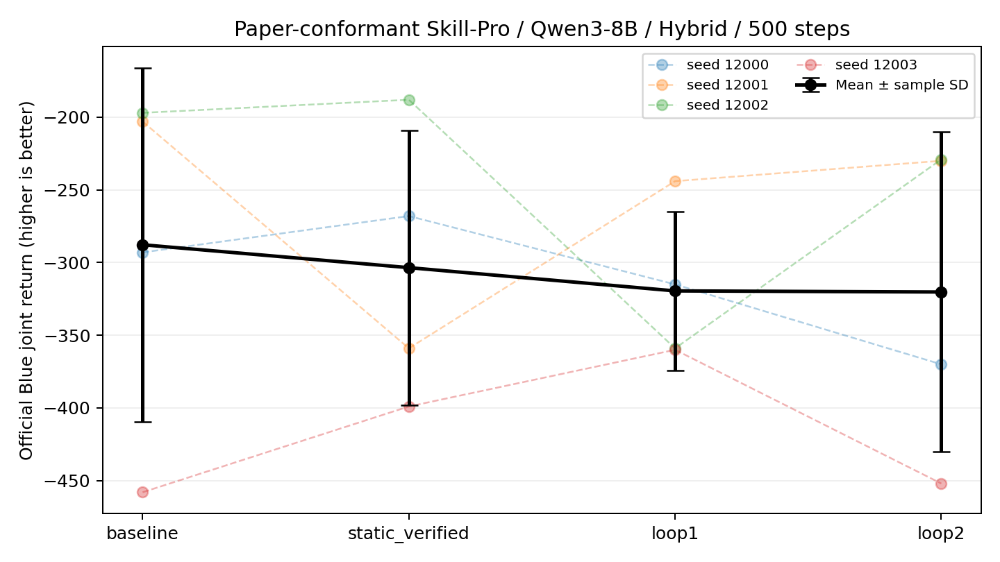
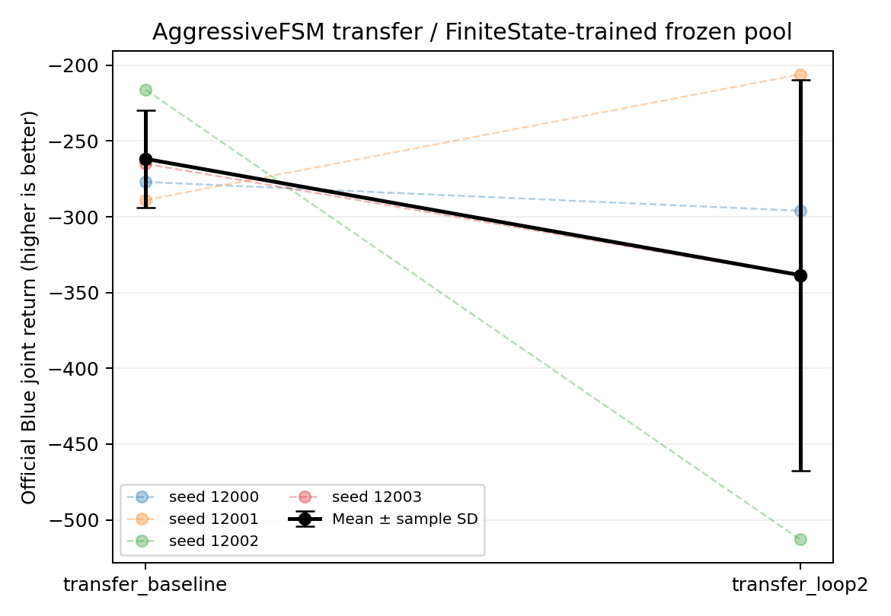

# Skill-Pro 출판 논문에 맞춘 CAGE4 최적화 수정

기준은 [PMLR 출판본](https://proceedings.mlr.press/v306/mi26d.html)의 §3–4와 Appendix Algorithm 1, [공식 코드](https://github.com/Miracle1207/Skill-Pro)다. 받은 PDF SHA256은 `475d6ce43b9ed6ab152afe7bd190a9fb4120962d22f4b6b45aca6cde55bd984b`이며 [로컬 사본](../references/Skill-Pro-PMLR-2026.pdf)을 보관했다.

기존 구현·설정·문서 43개는 `revisions/before-paper-fix-20261120/`에 보존했다. 기존 실제 실험 JSON/JSONL 135개의 SHA256도 [실험 사전 등록](../research_outputs/paper-fix/protocol.json)에 기록했다. CAGE4 보상·환경·KEEP 가중치와 `third_party` 원본은 수정하지 않는다.

## 논문과 실행 경로의 대응

| 항목 | 수정한 논문 실행 모드 | 보존한 공개 코드 재현 모드 |
|---|---|---|
| 학습 대상 | 고정 LLM의 외부 Skill Pool | 동일 |
| 선택·실행 | 고정 selector, Initiation/Policy/Termination | 동일 |
| 진화 대상 | Algorithm 1: 현재 배치에서 사용된 모든 Skill | 과거 버퍼 threshold·priority·max_evolutions |
| 진화 증거 | 현재 훈련 배치의 실제 궤적 | 성공·실패 혼합 과거 표본 |
| Semantic Gradient | 궤적별 추출 후 후보 간 재사용, 배치 aggregation | 기존 후보별 추출 경로 |
| Advantage | 전체 공동 시간축의 RTG − running baseline | episode advantage를 Skill 결정 수로 균등 분할 |
| 비율 | 동일 completion의 정확한 확률 비율 | 공개 코드의 log-ratio ±10 제한 |
| 승인 | **Best-of-N, J > 0** | 동일 기본 기준 |
| Score | 단계 보상 baseline 대비 활성 구간 평균 gain / 호출 수 | 공개 코드 `update_stats` |
| 관리 | Algorithm 1의 용량 초과 시 점수·중복 정리 | 공개 코드 LCB·성숙도 유지 |

`schedule=paper_batch`, `gate_mode=paper_rtg`, `maintenance_mode=paper_algorithm1`을 함께 사용한다. 서로 다른 방식의 설정을 조용히 섞으면 오류를 낸다. 신경망 PPO, LoRA, 보상 변경, 무조건 후보 승인, Parent 대비 점수 차이로 승인하는 새 Gate는 추가하지 않았다.

출판본 §4.3은 비양수 점수 제거를 설명하지만 Algorithm 1은 용량 초과 조건 안에서 정리를 호출한다. 이번 모드는 **Algorithm 1의 조건**을 따른다. 항상 정리하는 기존 `paper_score`도 남겼다. 새 후보의 온라인 점수는 새 경험을 얻기 전에는 관측되지 않았으므로, 관측 점수를 꾸며 넣지 않고 용량 제약 안에서 임시 보존한다. 이는 논문에 세부 동작이 지정되지 않은 cold start 처리이며, 용량 초과 시 새 후보도 제거될 수 있다.

## 고친 실행 문제

첫 배치부터 원본 공동 보상의 실제 시간축으로 RTG·단계 보상 baseline을 추정한다. 음수 보상 환경에서 단계 baseline을 0으로 고정해 모든 Skill을 해롭다고 처리하던 초기화를 피했다. 공식 점수에서 제외되는 terminal placeholder는 baseline·호출 통계에서도 제외한다.

논문 모드에서는 `last_evolved_iter=0`에 대한 초기 쿨다운이나 빈도 15 기준이 중요한 Skill을 뒤로 밀지 않는다. 현재 배치에서 쓰인 모든 Skill을 방문하므로 희귀 복구 Skill 한 개만 최적화하던 경로를 해소했다. 과거 다른 버전의 경험을 현재 Parent가 생성한 것처럼 Gate에 넣지 않는다.

CAGE4의 `IN_PROGRESS` 대기와 실제 모델 개입을 구분한다. 반복 검증은 두 번의 유효한 비대기 정책 결정과 **현재** 관측까지 같은 경우에만 작동한다. 자동 Sleep이나 정상 대기는 반복 실패로 분류하지 않는다.

E0와 Skill 비교군에 동일한 실행 행동·정식 대상 목록을 제공한다. Skill 이름은 지침이고 실행 행동이 아님을 명시한다. `WaitVerification`을 새 CAGE4 행동으로 만들어 우회하지 않으며, 원래 parser와 담당 host 범위 검사는 유지한다. 이 공통 인터페이스 수정은 무수정 ACD 재현과 구분하기 위해 `action_contract=explicit` 설정으로 표시한다.

행동 JSON 지시는 primitive actor에만 전달한다. selector와 termination에는 관측만 전달해 원본 XML 계약을 유지한다. 첫 구현 시도의 장기 실행 중 이 역할 경계가 섞인 것을 발견해 중단했고, `research_outputs/paper-fix-attempt-01-meta-contract-leak/`에 보존했다. 해당 시도는 최종 수정본 성능표에서 제외한다. 이 경계를 확인하는 회귀 테스트와 실제 메타 응답 기록을 추가했다.

Semantic Gradient에는 실제 해당 Blue의 관측과 전체 Skill 활성 구간만 전달한다. 비동기 행동·공동 보상의 의미를 함께 설명하고 특정 훈련 host/IP를 외우지 않도록 한다. 시간 순서를 유지한 chunk로 모든 기록을 처리하며 입력을 조용히 자르지 않는다. 논문 순서처럼 Gradient를 한 번 추출해 Best-of-N 후보들이 공유한다.

## 정확성·성능 확인

회귀·수식·배치 증거·반복 검증·공통 행동 계약·메타 출력 역할 분리·동일 모델 복제 검사를 포함한 **59개 테스트가 통과**했다. [최종 테스트 XML](../research_outputs/paper-fix-final-tests.xml). 초기 수정본의 56개 결과도 보존했다. Gate 제거 대조군이 모든 후보를 추가할 때도 후보끼리 이름이 겹치지 않도록 확인했다.

후보 이름은 actor prompt의 일부이므로 이름 충돌을 **Gate 전에** 처리한다. 평가를 통과한 뒤 이름을 바꾸어 다른 정책 문구를 저장하지 않는다. 장기 학습 뒤 발견한 기존 충돌 경로 한 건은 고정된 훈련 궤적 44개 결정으로 두 후보 모두 다시 점수화했다. 실제 저장 이름의 점수는 `12.0506148496`, `11.7791926748`로 모두 양수였고 기존 Best-of-N 선택도 같았다. 따라서 평가한 최종 Pool의 문구·구성은 바뀌지 않는다. [실제 이름 재검증](../research_outputs/paper-fix/candidate-identity-audit.json).

장기 학습 당시 코드와 최종 코드의 차이는 이 이름 확정 순서 한 곳이며, 각각 `revisions/paper-fix-long-run-20261120/`, `revisions/paper-fix-final-20261120/`에 SHA256과 함께 보존했다. 과거 실행을 새 코드로 다시 실행했다고 표시하지 않는다. [수정·동일 Pool 근거](../research_outputs/paper-fix/candidate-name-correction.json).

GPU 4개의 동일 BF16 Qwen에서 실제 생성 8건과 **캐시를 우회한** teacher forcing을 비교했다. 최대 sequence logprob 절대 차이는 `4.470348358154297e-7`, 허용 오차는 `1e-4`였다. [실제 점수 검증](../research_outputs/paper-fix/scoring-parity.json). 확률은 completion 토큰과 EOS의 logprob **합**이다. 이전 성능 분석의 “평균 token logprob” 표현은 실제 코드와 달라 바로잡았다.

GPU 복제와 생성 확률 캐시는 같은 확률 계산을 재사용하는 실행 최적화다. 다른 모델로 대체하거나 근사 확률을 쓰지 않는다. 기본 설정은 GPU 하나로 실행할 수 있다.

CAGE4의 비동기 행동에 맞춰, 실제 LLM이 호출되고 요청이 수락되는 결정만 Gate의 행동 표본으로 사용한다. busy tick의 자동 Sleep에는 생성 확률을 꾸며 넣지 않는다. 그동안의 공동 보상도 RTG에는 그대로 포함한다. 이는 CAGE4 어댑터의 명시적인 시간축 처리이며, 논문 환경의 무수정 재현이라고 표시하지 않는다.

성능 실험은 500-step 훈련 4 episodes / 2 loops, 별도 검증 seed 5000, 최종 비교 seeds **12000–12003**으로 사전 고정했다. E0, 학습 전 E3, loop 1 E3, loop 2 E3를 동일한 인터페이스와 조건으로 비교한다. 추가로 AggressiveFSM에서 E0와 loop 2 Pool의 전이를 확인한다. 평가 경험은 훈련에 넣지 않으며, 평가 보상을 보고 Pool을 고르지 않는다. 짧은 smoke 결과와 장기 성능은 구분한다.

이번 학습 전 대조군도 E3의 관찰 검증을 사용한다. 따라서 학습 전후 Skill 최적화 효과를 비교하며, E2와 E3의 검증 기능 자체의 추가 기여는 이번 실험만으로 추정하지 않는다. 공통 행동 계약과 평가 시드가 다른 과거 성능표와 차이를 계산해 수정 효과라고 주장하지 않는다.

## Closed-loop 학습 기록

| Loop | 훈련 시드 | 훈련 보상 | 훈련 평균 | 검증 seed 5000 | 진화 Parent / 승인 | Pool |
|---|---|---|---:|---:|---:|---:|
| 1 | 100, 101 | −399, −315 | −357.0 | −131 | 7 / 4 | 8 |
| 2 | 102, 103 | −271, −153 | −212.0 | −189 | 4 / 4 | 10 |

훈련 배치의 시드가 다르므로 훈련 평균 상승은 정책 개선의 증거가 아니다. 검증도 한 시드이므로 아래 별도 네 시드 평가로 판단한다. 모든 진화가 현재 배치를 사용했고 오류는 0건이었다. Semantic Gradient는 loop별 39, 37 chunks로 추출해 각 Best-of-2 후보가 공유했다.

| Loop | Parent | 후보 J (반올림) | 승인 후보 |
|---|---|---|---|
| 1 | HostInvestigation | −6.7397, −6.1291 | 없음 |
| 1 | ThreatRemoval | 1.0365, 0.8987 | ThreatRemoval_v2 |
| 1 | HostRecovery | −0.8433, 0.7750 | HostRecovery_v2 |
| 1 | DeceptionDeployment | −13.3970, −13.0325 | 없음 |
| 1 | NetworkContainment | −11.3303, −8.7601 | 없음 |
| 1 | TrafficRecovery | 25.6580, 27.2193 | TrafficRecovery_v2 |
| 1 | WaitVerification | 1.7780, 2.2542 | WaitVerification_v2 |
| 2 | DeceptionDeployment | 9.3368, 9.5738 | DeceptionDeployment_v2 |
| 2 | WaitVerification | 12.0506, 11.7792 | WaitVerification_v2_c0 |
| 2 | ThreatRemoval_v2 | 27.2500, 27.6320 | ThreatRemoval_v3 |
| 2 | WaitVerification_v2 | 22.7174, 22.9253 | WaitVerification_v3 |

Loop 2의 WaitVerification 행은 실제 저장 이름으로 재검증한 점수다. 최초 생성 이름으로 계산한 원시 로그의 값 `12.1294`, `11.5952`도 그대로 보존한다. 그 외 행은 원시 Gate 점수다.

용량 초과 정리에서 loop 1은 관측 점수가 비양수인 HostInvestigation, HostRecovery, NetworkContainment를 제거했다. Loop 2는 WaitVerification을 제거한 다음 용량 순위로 새 DeceptionDeployment_v2를 제거했다. 따라서 승인 4건이 곧 신규 Skill 4건의 최종 보존을 뜻하지 않는다. 학습되지 않은 신규 후보의 점수는 0이며 성공으로 꾸며 넣지 않았다.

## 별도 시드 성능 평가

FiniteState / Hybrid / nominal 500-step, 각 방식 **동일한 4개 평가 시드**의 실제 공식 공동 보상이다. 값이 클수록 좋다. ±는 표본 표준편차이며 신뢰구간이 아니다.

| 방식 | seed 12000 | 12001 | 12002 | 12003 | 평균 ± SD | 학습 전 E3 대비 |
|---|---:|---:|---:|---:|---:|---:|
| ACD + Qwen, E0 | −293 | −203 | −197 | −458 | −287.75 ± 121.70 | — |
| 초기 Skill + E3 검증, 학습 전 | −268 | −359 | −188 | −399 | −303.50 ± 94.52 | 0 |
| E3, closed-loop 1 | −315 | −244 | −359 | −360 | −319.50 ± 54.53 | −16.00 |
| E3, closed-loop 2 | −370 | −230 | −229 | −452 | −320.25 ± 110.01 | −16.75 |

**이번 표본에서는 최적화 후 성능 개선을 확인하지 못했다.** ACD 대비 평균 차이도 loop 1은 −31.75, loop 2는 −32.50이다. Loop 2와 학습 전 E3의 대응 차이는 `[-102, +129, -41, -53]`으로 4개 중 1개 시드에서만 높다. Loop 1 대비 loop 2의 평균 차이는 −0.75다.



FiniteState로 학습한 **최종 loop 2 Pool을 동결**해 학습하지 않은 AggressiveFSM으로 전이했다. 추가 학습은 없고 동일한 네 시드로 비교했다.

| 방식 | seed 12000 | 12001 | 12002 | 12003 | 평균 ± SD | ACD 대비 |
|---|---:|---:|---:|---:|---:|---:|
| ACD + Qwen, E0 | −277 | −289 | −216 | −265 | −261.75 ± 32.04 | 0 |
| 최종 loop 2 E3 | −296 | −206 | −513 | −339 | −338.50 ± 128.86 | −76.75 |

전이에서도 평균 개선을 확인하지 못했다. 대응 시드 차이는 `[-19, +83, -297, -74]`로 4개 중 1개만 높다. 학습 Skill 사용률은 60.82%지만 Analyse 요청은 222→158, 차단 요청은 27→0으로 줄었다. 작전 단계별 평균 차이는 `[-3.50, -28.00, -45.25]`다. 동결 정책의 행동 변화와 보상 손실의 인과적 기여를 분리한 결과는 아니다. AggressiveFSM의 loop 1이나 학습 전 E3는 이번 등록 실험에서 측정하지 않았다.



### 행동·작전 단계에서 관측한 변화

아래 행동은 Blue agent 4의 **실제 모델 결정**만 센다. 자동 busy Sleep을 제외하며, 보상은 원본 공동 보상을 바꾸지 않는다.

| 항목 | 학습 전 E3 | Loop 1 | Loop 2 |
|---|---:|---:|---:|
| 모델 결정 수, 4 episodes 합계 | 1644 | 1667 | 1706 |
| 학습 버전 Skill 사용률 | 0% | 52.97% | 59.79% |
| 모델이 선택한 Sleep 비율 | 82.18% | 84.40% | 85.99% |
| Analyse 요청 | 230 | 181 | 162 |
| Remove 요청 | 33 | 39 | 32 |
| BlockTrafficZone 요청 | 6 | 0 | 1 |
| 작전 단계 0 평균 보상 | −143.00 | −142.75 | −135.00 |
| 작전 단계 1 평균 보상 | −80.00 | −72.25 | −79.00 |
| 작전 단계 2 평균 보상 | −80.50 | −104.50 | −106.25 |

행동 파싱 오류와 selector/termination의 XML 형식 오류는 이 FiniteState 평가 16회에서 모두 0건이다. 별도로 selector가 목록에 없는 `.NONE`을 출력한 5건은 원본 selector에 의해 선택 없음으로 처리됐다. 이를 형식 오류 0건과 혼동하지 않도록 CSV에 따로 센다. 새 Skill의 사용률도 높아, 이번 부진을 “갱신이 실행되지 않았다”거나 “학습 Skill을 거의 쓰지 않았다”로 설명할 수는 없다.

관측상 부진과 연관된 변화는 다음과 같다.

- Pool 정리에서 HostInvestigation과 NetworkContainment가 제거됐고 이후 Analyse·차단 요청이 감소했다. 정보를 얻는 행동의 지연 효과를 단순 공동 보상 점수만으로 충분히 평가했는지는 별도 검증이 필요하다.
- Loop 2에서 Wait 계열 학습 Skill이 실제 결정 991/1706회(58.09%) 사용됐다. 전체 모델 Sleep 비율도 올라갔다. 단, Skill은 지침이므로 Wait 계열에서 나온 모든 행동이 Sleep인 것은 아니다.
- 학습 전 대비 loop 2 보상 차이 −16.75는 작전 단계 0의 +8.00, 단계 1의 +1.00, 단계 2의 −25.75로 나뉜다. 특히 마지막 작전 단계에서 손실이 커졌다.
- 공동 보상에는 KEEP 4명과 Red/Green 상호작용도 기여한다. 관측 gain과 RTG는 특정 Skill의 인과적 기여를 분리하지 않는다. 위 변화가 손실의 전부를 일으켰다고 단정하지 않는다.
- 훈련은 4 episodes / 2 loops에 그쳤다. HostRecovery의 첫 Gate 증거는 실제 정책 결정 5개뿐이며, 학습된 HostRecovery는 각 loop 평가에서 1회만 사용됐다. 승인된 TrafficRecovery_v2는 두 평가 모두 0회 사용됐다. 희귀 Skill의 학습·일반화 근거는 제한적이다.

## Gate 승인이 보상 개선을 보장하지 않는 이유

진단 목적으로 같은 증거에서 부모의 비율을 `r=1`로 놓은 surrogate와 승인 후보의 surrogate를 비교했다. **승인 조건을 바꾸는 데 사용하지 않았다.** 다음 값은 실제 에피소드 보상이나 별도 Parent 재실행 성능이 아니라, 저장된 동일 행동·Advantage에 대한 PPO surrogate다.

| Loop | Parent | 부모 r=1 surrogate | 승인 후보 J | 차이 |
|---|---|---:|---:|---:|
| 1 | ThreatRemoval | 1.0446 | 1.0365 | −0.0081 |
| 1 | HostRecovery | 8.6706 | 0.7750 | −7.8956 |
| 1 | TrafficRecovery | 40.5696 | 27.2193 | −13.3502 |
| 1 | WaitVerification | 5.3328 | 2.2542 | −3.0785 |
| 2 | DeceptionDeployment | 18.6026 | 9.5738 | −9.0288 |
| 2 | WaitVerification | 14.2038 | 12.0506 | −2.1532 |
| 2 | ThreatRemoval_v2 | 28.9677 | 27.6320 | −1.3357 |
| 2 | WaitVerification_v2 | 25.6147 | 22.9253 | −2.6894 |

논문의 `J > 0`은 `J(candidate) > J(parent)`와 다르다. 이 표본에서는 승인 8건 모두 양수지만 부모 기준보다 낮았다. 전체 공동 RTG에서 baseline을 뺀 뒤 특정 Skill의 활성 결정만 고르면 그 부분 표본의 Advantage 평균이 0일 필요도 없다. 따라서 Gate가 수식대로 계산되어도 후보가 부모보다 개선되었다고 인증하는 것은 아니다. 부모 대비 차이를 새 승인 조건으로 추가하면 요청한 논문 방법에서 달라지므로 추가하지 않았다. [후보·부모 진단 CSV](../research_outputs/paper-fix/report/evolution.csv).

학습 전 Pool과 각 loop의 Pool은 모두 E3이므로, 이번 비교는 이를 구분하는 전용 집계기를 사용한다. 원시 로그에서 공동 보상을 한 번씩 합산하고, 각 후보의 수식·현재 배치 증거·동결 Pool을 검사한다.

```bash
.venv/bin/python scripts/report_paper_fix.py --require-complete
```

최종 집계 상태는 **completed**, 누락 평가 0건이다. 실제 500-step 실험은 훈련 4 + 별도 검증 2 + 평가 24 = **30 episodes**다. 별도 20-step smoke 3 episodes와 동일 baseline의 재현 대조는 성능 표본에 추가하지 않았다. 평가 24회의 실제 모델 결정 9949건에서 행동 파싱 오류 0건, XML 형식 오류 0건이며, 인식 불가 선택 이름은 위의 `.NONE` 5건이다.

[전체 CSV·시드별 기록](../research_outputs/paper-fix/report/performance.md), [기계 판독 결과와 감사](../research_outputs/paper-fix/report/results.json), [사전 고정한 실험 계획](../research_outputs/paper-fix/protocol.json)을 보관했다. 임시 GPU 복제 서버 3개는 실험 완료 후 종료했고 기본 로컬 Qwen 서버 8018은 준비 상태다. [서버 정리 기록](../research_outputs/paper-fix-server-cleanup.json).

이 실험으로 확인한 것은 실행·수식·실제 후보 재사용의 정상 동작과 **이번 표본에서의 성능 미개선**이다. 4개 평가 시드와 2 loops만으로 다른 시나리오나 더 큰 훈련 예산의 성능을 단정하지 않는다. 논문 범위에서 후속 실험을 한다면 훈련 경험·Best-of-N·Pool 용량은 별도 검증 시드로 정하고 새 평가 시드를 사용해야 한다. 이번 평가 보상을 보고 승인 기준이나 보상 함수를 바꾸지는 않았다.

## 실행

```bash
cd /home/jeonges/proposed
CUDA_VISIBLE_DEVICES=0 ./scripts/start_qwen.sh --port 8018
# 다른 터미널: 기본 설정은 GPU 하나로 충분하다.
./research.sh train --config research_configs/paper-cage4-fixed.yaml --output research_outputs/paper-next/E3-hybrid-finite/train
./research.sh evaluate --config research_configs/paper-cage4-fixed.yaml --output research_outputs/paper-next/E3-hybrid-finite/eval
# 중단된 같은 코드·설정 실행만 --resume으로 재개한다.
```

기본 E3 평가기는 eval의 형제 `train/checkpoint.json`을 읽는다. 위 `paper-next`는 새 실행 디렉터리 예시이며, 이미 존재하면 다른 이름을 쓴다. `--arm E0` 평가와 초기 Pool 대조는 별도 output을 사용한다. `paper-cage4-fixed-4gpu.yaml`은 8018–8021에 같은 모델을 실행했을 때 사용하는 선택적 병렬 점수 설정이다. 이전 코드와 구현 hash가 달라진 실행을 같은 디렉터리에서 재개하려 하면 거부한다.
