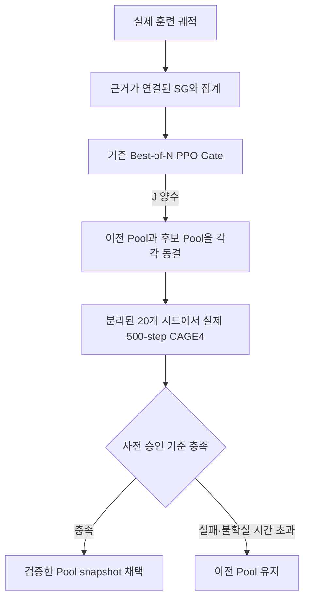

# CAGE4 Closed-loop 검증 개선 방법

기존 코드와 실험은 보존하고 `revisions/rollout-v5`에 추가 검증을 구현했다. 실제 통합의 검증 snapshot 메타데이터 오류는 별도 `revisions/rollout-v5-metadata-fix`에서 수정했다. 최종 테스트 전 정적 B1이 지정된 공통 Pool을 읽도록 한 줄을 고친 `revisions/rollout-v5-static-pool-fix`를 `research_v5.sh`가 실행한다. 프로젝트와 상위 디렉터리는 Git 저장소가 아니므로 존재하지 않는 변경 전 commit을 만들었다고 표시하지 않는다. 원본 저장소 commit과 변경 전 파일 hash는 [작업 기록](../research_outputs/rollout-v5/work_state.json), 수정 범위는 [source provenance](../revisions/rollout-v5/fork_provenance.json)에 있다.

## 유지한 부분

CAGE4/CybORG, 네트워크, Red FSM, Green, KEEP 4 + Qwen3-8B 1, 500-step와 공식 공동 보상을 유지했다. 모델 가중치는 고정했다. `behavior.py`와 `adapter.py`는 v4와 byte 단위로 같으며 B0–B4의 관측 이력·Sleep·primitive 메뉴도 같다. `gate.py`와 `paper_algorithm.py` 역시 v4와 byte 단위로 같다.

[Skill-Pro 출판 논문](https://proceedings.mlr.press/v306/mi26d.html)의 Skill-MDP, I/π/β, 원본 selector, 현재 배치 Semantic Gradient와 집계, 정확한 old/new token 확률, RTG clipped objective, Best-of-N `J>0`, score 기반 용량 관리를 B2에 유지한다. 새로운 neural PPO, LoRA, 보상 가중치나 개별 Blue 보상은 넣지 않았다.

## 실험군

| ID | 실행 모드 | 자동 갱신 | 추가 검증 |
|---|---|---|---|
| B0 | E0 | 없음 | 동일 사건 이력 ACD |
| B1 | E1 | 없음 | 공통 초기 수동 7개 Skill |
| B2 | E2 | 원본 논문 모드 | 기존 PPO Gate |
| B3 | E2 + Proposed 확장 | 근거가 확인된 SG와 기존 PPO Gate | 실제 CAGE4 rollout admission |
| B4 | E3 + Proposed 확장 | B3와 동일 | CAGE4 사건 기반 initiation 우선순위 |

B3에는 SG 출처 검증과 제한된 후보 검증 순서도 포함한다. 따라서 B3−B2를 순수한 rollout 하나만의 인과 효과라고 부르지 않는다. B4 우선 실행으로 B3가 검증 시간을 덜 받았다면 그 차이도 보고한다. 원본 공동 Reward 귀속 방식은 B2에 남는다.

## 보완한 Skill 시작 조건

v4는 완료된 과거 사건, 실패한 Remove, 새 PID, 성공한 Restore 뒤 재침해와 busy를 구분한다. 이 공통 이력은 바꾸지 않았다. B4만 다음 조건 충돌을 추가로 검증한다.

- 관리 권한 침해가 이미 관측됐다면 Remove 후 확인 flag를 이유로 EscalationDiagnosis를 계속 선택하지 않는다. PrivilegedRecovery를 검토한다.
- 새 PID에 아직 대응하지 않았다면, 같은 근거를 다시 찾기 위한 Analyse보다 RapidProcessResponse를 검토한다.
- 같은 evidence version의 Remove가 FALSE라면 맹목적인 재시도보다 진단을 검토한다. 새 PID/evidence version이나 실패 후 성공한 재분석이 있으면 대응을 다시 평가할 수 있다.
- 다른 host의 새 증거는 한 host의 실패 때문에 함께 막지 않는다.

이것은 Skill 시작 검증이며 primitive를 스크립트로 대신 선택하는 정책이 아니다. Restore를 일괄 억제하지 않으며 Sleep도 계속 선택할 수 있다. Mission phase와 복구 비용은 기존 관측·Skill 절차로 평가한다. 선택 횟수 자체를 목표 보상으로 만들지 않는다.

## SG 근거 검증

SG는 현재 배치에서 해당 Blue가 실제로 실행한 Skill 구간 전체를 시간·문자 수별 청크로 읽는다. 다른 Blue/Red/Green의 숨겨진 전체 상태를 읽는다는 뜻은 아니다. 행동 전후 관측, busy/정책 호출, 완료 상태, 실제 공동 보상, 사건 이력을 구분한다.

각 청크의 실제 record에 `E0`, `E1` 같은 ID를 붙이고 모델이 변경 성분별 근거 ID·필드를 선택하게 한다. 검증기는 그 ID를 원래 step·Blue ID·정확한 기록 값으로 되돌려 저장한다. 없는 ID, 다른 actor/step, 숨겨진 필드, 근거가 없는 성분 변경은 거부한다. 근거가 전부 거부됐을 때 일반적인 NEW Skill 생성으로 우회하지 않는다. 훈련 host instance/IP를 외운 후보도 채택하지 않는다.

처음의 자유 인용 방식은 실제 Qwen에서 부정확한 JSON 인용을 만들었고, 단순히 추가한 ID 안내도 모델이 출력 schema에서 누락했다. 두 실패 실험은 `smoke`, `smoke-catalog`에 보존했다. 구체적인 JSON 출력 schema에 evidence를 포함한 뒤 실제 훈련 기록 세 조각의 출처 연결이 모두 통과했다. 이것들은 40-step 통합·출처 점검이며 500-step 성능 표본이 아니다. [최종 출처 점검](../research_outputs/rollout-v5/evidence-schema-probe.json).

정확한 ID는 의미 해석의 정답이나 인과적 책임까지 증명하지 않는다. 조용한 Sleep을 실패로 해석하는 SG가 나올 수 있어 실제 rollout 검증이 필요하다.

## PPO 뒤의 실제 환경 검증과 rollback



살아 있는 훈련 Pool에 후보를 먼저 넣지 않는다. 독립 복사에 후보와 원본 capacity maintenance를 적용한 **실제 최종 snapshot**을 검증한다. 완료 전·실패·예외에서 live Pool hash가 그대로여야 하며, 성공 시 검증한 snapshot을 그대로 채택한다. 검증 에피소드는 경험 버퍼, RTG baseline, Skill 통계에 추가하지 않는다.

사전 기준은 20개 시드의 양쪽 결과 완성, 평균 대응 차이 >0, 개선 비율 ≥0.6, 중앙값 ≥0, 최악 시드 손실 ≤50, 평균 LWF/ASF 손실 증가 없음, 보상 SD가 `max(기존 SD×1.25, 기존 SD+25)` 이하이다. 공식 보상을 바꾼 수식이 아니라 별도의 Proposed 채택 조건이다. 최종 테스트를 보고 바꾸지 않는다. 미완료 검증은 성공이나 0점으로 간주하지 않는다.

최초 실제 검증에서는 Pool 파일에 평가 로더가 요구하는 `episodes_completed`가 빠져 첫 worker들이 점수를 내기 전에 실패했다. 후보는 채택되지 않았고 live Pool도 같았다. 별도 revision에서 이 count와 `total_training_episodes`만 추가하고, 수정 전 동일 KeyError 재현 및 수정 후 실제 평가 로더 통과를 확인했다. 기존 훈련 궤적·생성 후보를 다시 만들지 않고 이전/후보 Pool hash의 완전 일치를 확인한 뒤 같은 시드에서 재검증한다. 원본 코드·실패 로그, 승인 기준, 최초 예산 종료 시각을 보존했다. [수정 전 등록](../research_outputs/rollout-v5/metadata-repair-protocol.json), [138개 전체 회귀 검사](../revisions/rollout-v5-metadata-fix/research_outputs/metadata-final-tests.xml).

최종 비교 감사에서는 E1이 지정한 Pool 경로를 무시하고 기본 6개 Skill을 만드는 기존 경로도 발견했다. 최종 테스트 전에 E1도 명시된 Pool을 읽도록 조건 한 줄을 보완해 등록한 공통 수동 7개 Pool을 실제로 사용하게 했다. 수정 전 불일치와 수정 후 snapshot의 완전 일치를 검사했다. E0/E2/E3의 실행·훈련·진행 중 후보 검증은 바뀌지 않았다. [테스트 전 수정 등록](../research_outputs/rollout-v5/static-pool-repair-protocol.json), [139개 전체 회귀 검사](../revisions/rollout-v5-static-pool-fix/research_outputs/static-pool-final-tests.xml).

## 희귀 Skill과 공동 보상

8시간 예산에서는 관측 근거가 가장 많은 부모부터 검사하고 arm/loop당 PPO 양수 후보 최대 한 개를 20시드 환경 검증에 보낸다. 나머지는 부모를 유지하고 `deferred`로 기록한다. 이것은 원본 Algorithm 1의 새 수식이 아니라 Proposed의 명시적인 검증 자원 제한이다. B2는 원래 사용한 모든 부모를 처리한다.

최소 결정 수 0·4·8·16·32의 민감도는 실제 검증에 연결해 기록한다. 한 후보가 모든 cutoff에서 동일하게 선택된다면 최적값은 식별되지 않는다. 이 경우 임의로 ‘검증된 최적 최소 경험 수’를 선언하지 않는다. 사용 횟수·성공/실패 상태·phase·Red·RTG/Advantage·수정/승인 내역은 원시 trace와 Gate 진단에서 확인한다.

공동 보상 귀속은 여전히 인과적 개별 보상이 아니다. [사건별 진단](reward_root_cause.md)은 서비스 손상을 일으킨 실제 Red 행동과 Green 실패 분기를 확인하지만 이를 Qwen Skill의 개별 기여로 바꾸지 않는다. 같은 시드에서 상태가 갈라진 뒤의 상관관계도 인과효과로 표시하지 않는다. 보조 counterfactual 결과는 검증된 짧은 구간만 별도 보고하며 보상 보정·학습 신호로 사용하지 않는다.

## 실제 실행 예산과 데이터 분리

사용자가 정한 모델 실행 총 경과 시간은 최대 8시간, GPU는 최대 4개다. smoke와 출처 점검도 이 clock에 포함했다. 훈련 61000–61001, 후보 검증 62000–62019, 최종 FiniteState 64000–64099, 미학습 Red 정책 65000–65099를 분리했다. 검증을 우선하고 최종 평가 100개 시드 전체를 완료한 것으로 추정하지 않는다.

현재 예산 계획은 학습 arm당 실제 2 episodes / 자동 갱신 1 loop다. API·설정은 후속 loop를 지원하지만 이번에 실행하지 않은 loop 2의 수치를 만들지 않는다. 최종 테스트 전에 committed Pool을 동결하고, commit이 없는 arm은 초기 Pool을 사용한다. 최종 선택은 테스트 보상을 사용하지 않는다. [등록 프로토콜](../research_outputs/rollout-v5/protocol.json).

최종 표와 8개 그래프, 대응 평균·승률·중앙값·95% CI·실제 N·전체 미실시 항목은 [실측 보고서](../research_outputs/rollout-v5/report/performance.md)에 생성한다. CI는 대응 시드 bootstrap이며 작은 N의 통계 우위를 보장하지 않는다.

## 재현 명령

현재 실험은 `scripts/rollout_v5_campaign.py --launch`로 중복 시작하지 않는다. 기존 결과를 감사하려면:

```bash
cd /home/jeonges/proposed
.venv/bin/python scripts/report_rollout_v5.py --require-terminal
```

새 학습은 다음처럼 실행할 수 있다. 아래 설정은 별도 미사용 시드 71000/72000/74000과 새 output을 사용하고, 기존 8018 단일 GPU로 실행한다. 이번 예산의 종료 시각이나 정리된 복제 서버에 의존하지 않는다. **이 미래 2-loop/100시드 설정을 현재 실측으로 집계하지 않는다.**

```bash
./research_v5_reusable.sh train --config research_configs/rollout-B4.yaml
./research_v5_reusable.sh evaluate --config research_configs/rollout-B4.yaml \
  --pool /home/jeonges/proposed/research_outputs/rollout-reproduction/B4/E3-hybrid-finite/train/pool-iteration-0002.json
```

`rollout-B0.yaml`–`rollout-B4.yaml`이 각 실험군의 별도 설정이다. 평가 시에는 학습한 Pool을 명시해야 하며, 초기 수동 Pool을 평가한 결과와 구분한다. 20시드 환경 검증의 parent 선택 예산은 설정의 `maximum_rollout_candidates_per_iteration`으로 선언한다.

여러 loop와 warm start를 위한 `research_v5_reusable.sh`는 별도 복사본에서 검증 snapshot의 훈련 provenance만 보강한다. 전체 훈련 계획 수가 아닌 현재 완료된 loop 경계의 episode·seed와 상속된 episode·seed·iteration을 기록한다. actor·SG·Gate·검증 기준·보상은 측정 revision과 동일하다. 이번 8시간 캠페인은 계속 등록한 metadata-fix revision에서 실행하며 이 보강본의 추가 성능을 주장하지 않는다.

이 재사용 보강본은 [전체 141개 검사](../revisions/rollout-v5-reusable/research_outputs/reusable-static-pool-final-tests.xml)를 통과했다. 홀수 episode를 두 loop로 나눈 첫 경계와 이전 loop 이력을 상속한 warm start도 검사했다. [정확한 변경 파일·source hash·별도 성능 실험 없음](../revisions/rollout-v5-reusable/fork_provenance.json).

이번 캠페인에서 고정한 최종 Proposed Pool을 별도 디렉터리에 다시 평가할 때는 등록 설정과 frozen Pool을 그대로 지정한다. 아래 명령은 새로 평가를 실행하므로 캠페인 완료 뒤 별도의 계산 예산이 필요하다.

```bash
./research_v5.sh evaluate \
  --config /home/jeonges/proposed/research_outputs/rollout-v5/B4-config.json \
  --pool /home/jeonges/proposed/research_outputs/rollout-v5/frozen/B4.json \
  --episodes 4 --output /home/jeonges/proposed/research_outputs/rollout-final-reproduction/B4
```

동결 전에 이 최종 Pool이 있는 것으로 가정하지 않는다. 현재 캠페인은 `scripts/rollout_v5_repaired_campaign.py`가 기존 종료 시각으로 관리하며, 복구 사전등록의 source/driver hash가 달라지면 추가 실험을 차단한다.
