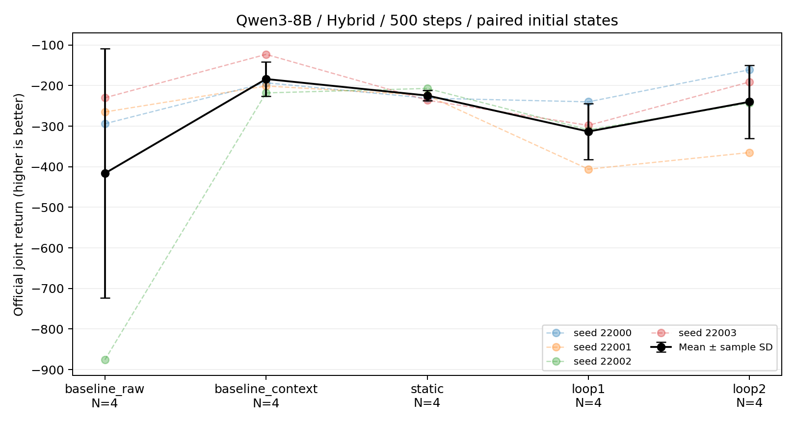
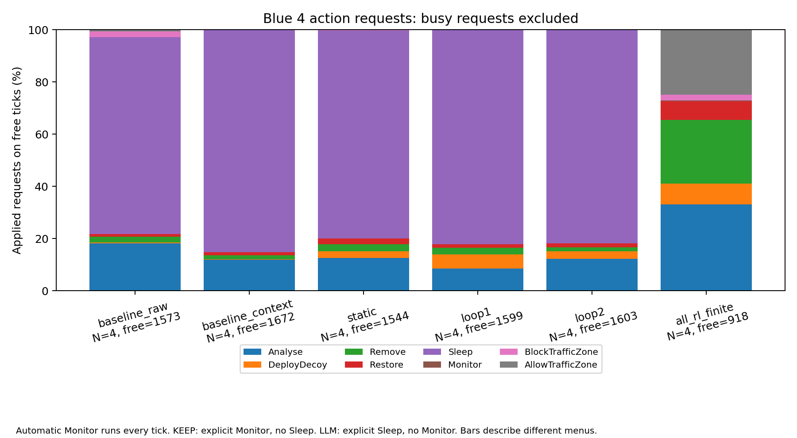
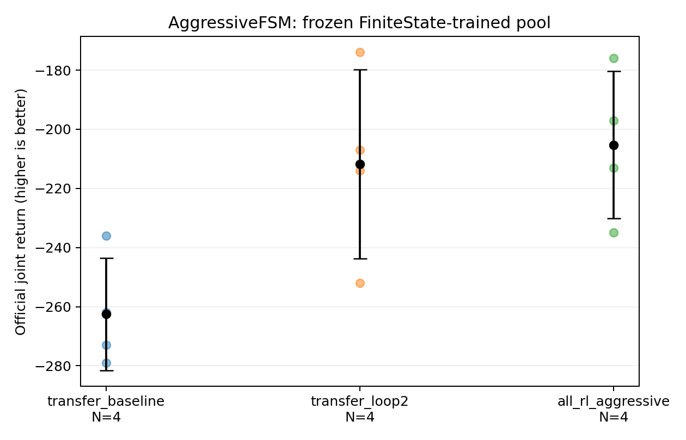
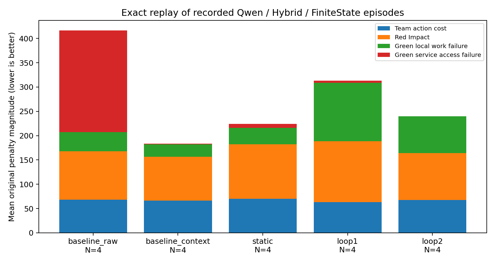

# 행동 이력·대응 Skill 수정 후 실제 성능

상태: completed. 500-step / frozen Qwen3-8B / Hybrid / heldout [22000, 22001, 22002, 22003].

| 방식 | 구분 | N | 평균 공동 보상 | 표본 SD | 시드별 보상 |
|---|---|---:|---:|---:|---|
| validation_baseline | validation | 1 | -132.0 | None | {'23000': -132.0} |
| validation_initial | validation | 1 | -225.0 | None | {'23000': -225.0} |
| validation_loop1 | validation | 1 | -175.0 | None | {'23000': -175.0} |
| validation_loop2 | validation | 1 | -80.0 | None | {'23000': -80.0} |
| baseline_raw | heldout | 4 | -416.25 | 307.61488368846307 | {'22000': -294.0, '22001': -265.0, '22002': -876.0, '22003': -230.0} |
| baseline_context | heldout | 4 | -183.75 | 41.82005101224372 | {'22000': -193.0, '22001': -201.0, '22002': -218.0, '22003': -123.0} |
| static | heldout | 4 | -224.5 | 12.662279942148386 | {'22000': -231.0, '22001': -224.0, '22002': -207.0, '22003': -236.0} |
| loop1 | heldout | 4 | -313.25 | 68.84463184107628 | {'22000': -240.0, '22001': -406.0, '22002': -309.0, '22003': -298.0} |
| loop2 | heldout | 4 | -240.0 | 89.95554457619608 | {'22000': -161.0, '22001': -365.0, '22002': -243.0, '22003': -191.0} |
| transfer_baseline | heldout | 4 | -262.5 | 19.017535767461215 | {'22000': -236.0, '22001': -262.0, '22002': -279.0, '22003': -273.0} |
| transfer_loop2 | heldout | 4 | -211.75 | 32.00390601161052 | {'22000': -207.0, '22001': -252.0, '22002': -174.0, '22003': -214.0} |
| all_rl_finite | control | 4 | -198.25 | 49.80210838910337 | {'22000': -182.0, '22001': -206.0, '22002': -143.0, '22003': -262.0} |
| all_rl_aggressive | control | 4 | -205.25 | 24.958298553119896 | {'22000': -176.0, '22001': -235.0, '22002': -197.0, '22003': -213.0} |

## 대응 시드 차이

| 비교 | N | 평균 차이 | 개선 시드 수 | 시드별 차이 |
|---|---:|---:|---:|---|
| baseline_context - baseline_raw | 4 | 232.5 | 4 | [101.0, 64.0, 658.0, 107.0] |
| static - baseline_context | 4 | -40.75 | 1 | [-38.0, -23.0, 11.0, -113.0] |
| loop1 - static | 4 | -88.75 | 0 | [-9.0, -182.0, -102.0, -62.0] |
| loop2 - static | 4 | -15.5 | 2 | [70.0, -141.0, -36.0, 45.0] |
| loop2 - baseline_context | 4 | -56.25 | 1 | [32.0, -164.0, -25.0, -68.0] |
| loop2 - baseline_raw | 4 | 176.25 | 3 | [133.0, -100.0, 633.0, 39.0] |
| loop2 - loop1 | 4 | 73.25 | 4 | [79.0, 41.0, 66.0, 107.0] |
| transfer_loop2 - transfer_baseline | 4 | 50.75 | 4 | [29.0, 10.0, 105.0, 59.0] |

## Closed-loop 훈련·별도 검증

훈련 평균은 갱신 전 Pool의 서로 다른 훈련 시드 성능이다. 학습 효과는 위 동일 평가 시드의 동결 Pool 결과로 판단한다.

| Loop | 훈련 시드 | 훈련 보상 | 훈련 평균 | 검증 보상 | 승인 Skill | Pool |
|---|---|---|---:|---:|---|---:|
| 1 | [21000, 21001] | [-323.0, -304.0] | -313.5 | -175.0 | SelectiveDeception_v2, TrafficRecovery_v2 | 8 |
| 2 | [21002, 21003] | [-198.0, -207.0] | -202.5 | -80.0 | RapidProcessResponse_v2, EscalationDiagnosis_v2, PrivilegedRecovery_v2, SelectiveDeception_v2_c1, NetworkContainment_v2, SelectiveDeception_v3 | 14 |

## Blue 4의 free tick 요청

아래는 각 조건 에피소드의 합계다. busy 중 요청·지속 행동의 tick·자동 Monitor를 신규 모델 선택으로 합산하지 않는다.

| 방식 | N | free / busy | Analyse | DeployDecoy | Remove | Restore | Sleep | 명시적 Monitor | Block / Allow |
|---|---:|---|---:|---:|---:|---:|---:|---:|---|
| baseline_raw | 4 | 1573 / 423 | 285 | 6 | 34 | 16 | 1188 | 0 | 35 / 9 |
| baseline_context | 4 | 1672 / 324 | 200 | 2 | 25 | 19 | 1426 | 0 | 0 / 0 |
| static | 4 | 1544 / 452 | 193 | 39 | 44 | 33 | 1229 | 0 | 3 / 3 |
| loop1 | 4 | 1599 / 397 | 135 | 88 | 39 | 24 | 1313 | 0 | 0 / 0 |
| loop2 | 4 | 1603 / 393 | 195 | 47 | 24 | 26 | 1311 | 0 | 0 / 0 |
| all_rl_finite | 4 | 918 / 1078 | 304 | 73 | 224 | 65 | 0 | 4 | 19 / 229 |

## Gate 계산과 실제 개선의 구분

부모 r=1 기준은 같은 저장 행동·Advantage에 대한 surrogate이며 별도 부모 재실행 보상이 아니다. 승인 조건은 논문의 Best-of-N, J>0을 유지했다.

| Loop | Parent | 실제 정책 표본 | 부모 r=1 surrogate | 후보 J | 승인 |
|---|---|---:|---:|---|---|
| 1 | RapidProcessResponse | 31 | -30.817469169826442 | [-28.98243796178889, -26.529571532458817] |  |
| 1 | EscalationDiagnosis | 43 | -22.59702610054427 | [-26.33229728913891, -25.976741712669437] |  |
| 1 | PrivilegedRecovery | 2 | -23.45611428055001 | [-18.76489142444001, -18.76489142444001] |  |
| 1 | SelectiveDeception | 277 | 7.9638359140137 | [2.711081116493573, 1.738152545315188] | SelectiveDeception_v2 |
| 1 | NetworkContainment | 66 | -8.154171056660342 | [-14.715592473656876, -18.341303626592353] |  |
| 1 | TrafficRecovery | 2 | 12.152823303366578 | [7.405044309066307, 7.405064360751034] | TrafficRecovery_v2 |
| 2 | RapidProcessResponse | 40 | 18.606068493524013 | [-36.02467702105155, 1.4592051158944255] | RapidProcessResponse_v2 |
| 2 | EscalationDiagnosis | 130 | 18.830240127261206 | [2.3129307515494686, 2.48700245185891] | EscalationDiagnosis_v2 |
| 2 | PrivilegedRecovery | 2 | 40.22993152031913 | [24.587817978687436, 2.8082772145060263e-07] | PrivilegedRecovery_v2 |
| 2 | SelectiveDeception | 30 | 18.602704155234417 | [8.432178307699267, 9.144423359061937] | SelectiveDeception_v2_c1 |
| 2 | NetworkContainment | 9 | 27.721737834315704 | [16.974751545107686, 19.460690461449268] | NetworkContainment_v2 |
| 2 | SelectiveDeception_v2 | 410 | 20.703705526709427 | [15.799954857587071, 15.641181031087237] | SelectiveDeception_v3 |

공통 이력 효과는 baseline_context−baseline_raw, 정적 Skill 효과는 static−baseline_context, 학습 효과는 각 loop−static으로 분리한다.
현재 KEEP 메뉴에는 explicit Monitor가 있고 Sleep이 없다. LLM 메뉴에는 Sleep이 있고 explicit Monitor가 없다. 자동 Monitor는 양쪽 모두 매 tick 수행한다. Sleep/Monitor는 보조적으로 수동적 선택 범주로 묶되 실제 메뉴와 개별 행동 횟수도 함께 보존한다.
행동 분포는 busy tick을 제외한 실제 선택 기회를 분모로 한다. 이 공개 KEEP와 논문의 별도 학습된 KEEP를 동일한 정책으로 취급하지 않는다.
free_choice_actions는 free tick에 적용된 요청이며 파싱 실패 시 fallback Sleep을 포함한다. 순수한 유효 모델 선택과 실패 fallback은 valid_generated_choice_actions·invalid_policy_fallback_actions로 별도 제공한다.
environment_last_action_ticks는 환경이 매 tick 반환한 실행 행동 기록이다. 지속 행동의 여러 tick과 자동 Monitor를 포함할 수 있어 신규 결정 수와 더하거나 동일시하지 않는다. LLM의 완료 TRUE/FALSE도 agent_behavior.csv에 별도 보존한다.
All RL은 동일 시드·Blue 4 위치의 대조이며 모든 Blue의 정책 구성이 Hybrid와 다르다. 한 에피소드 행동 빈도로 평균 방어 성능을 대신하지 않는다.
N=4이며 표본 SD는 신뢰구간이 아니다. 관측 사례의 반응 지연·반복 지표는 진단이며 보상 함수를 대체하지 않는다.
duplicate_successful_decoy는 같은 host의 과거 성공 후 재요청이다. 다른 서비스 추가나 Restore 후 재배치가 가능하므로 불필요한 행동으로 단정하지 않는다. 관측된 서비스별 재배치는 decoy_deployment_diagnostics에서 별도로 제공한다.
실행 시간은 병행 GPU 추론의 대기 시간도 포함한다. 이 캠페인의 조건별 시간을 추론 효율의 비교 지표로 사용하지 않는다.

