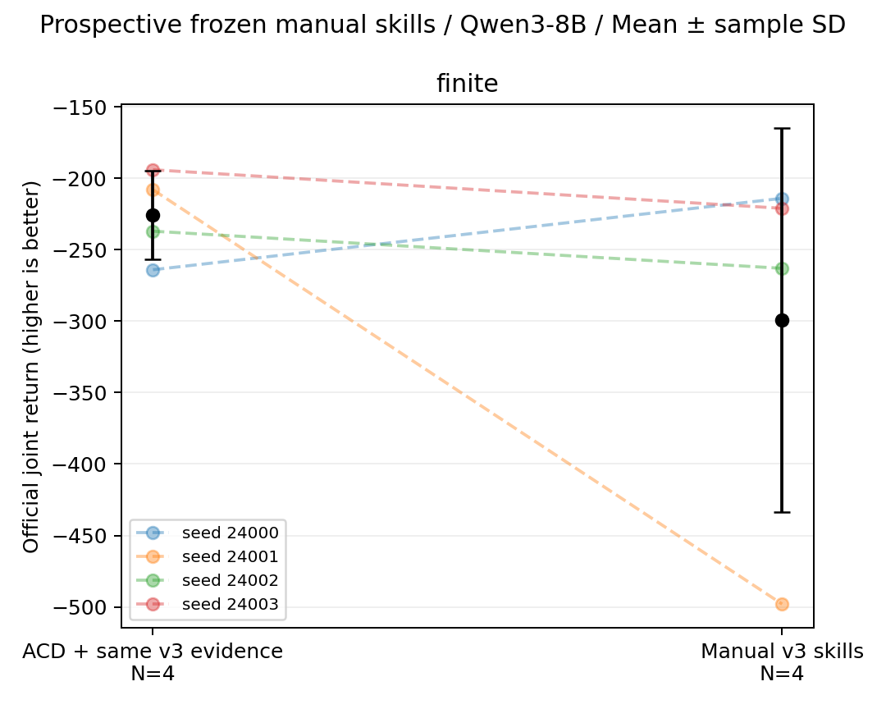

# v3 수동 Skill 보완의 전향적 평가

상태: completed. 같은 v3 사건·연결 이력과 Sleep 선택지를 공유한다. Qwen3-8B/Hybrid/500-step, Pool 동결.

수동 7개 초기 Skill과 관찰 기반 검증의 평가다. closed-loop 학습 Skill의 개선 수치로 합산하지 않는다.

| Red | 방식 | N | 평균 공동 보상 | 표본 SD | 시드별 보상 |
|---|---|---:|---:|---:|---|
| finite | E0 | 4 | -225.75 | 31.159535726109056 | {'24000': -264.0, '24001': -208.0, '24002': -237.0, '24003': -194.0} |
| finite | E3 | 4 | -299.0 | 134.41974061374566 | {'24000': -214.0, '24001': -498.0, '24002': -263.0, '24003': -221.0} |

| Red | 대응 N | E3−E0 평균 | 개선 시드 | 시드별 차이 | 사전 기준 통과 |
|---|---:|---:|---:|---|---|
| finite | 4 | -73.25 | 1 | [50.0, -290.0, -26.0, -27.0] | False |

사전 기준은 평균 차이 양수·4개 시드 중 3개 이상 개선이다. FiniteState에서 통과하지 않으면 AggressiveFSM은 사전 조건으로 미실시한다. 미실시를 0점이나 성공으로 표시하지 않는다.
전이 평가 상태: not_run_finite_criterion_failed. N=4의 표본 SD는 신뢰구간이 아니다. 개발 시드 23000의 +5를 최종 표본으로 재사용하지 않는다.

설정의 development_validation은 개발 설정에서 복사된 비동작 메타데이터다. 실행 코드는 이 태그를 읽지 않는다. 실제 구분은 고정 프로토콜의 개발 23000, 새 평가 24000–24003, 조건부 전이 25000–25003으로 감사한다.
미완료 표의 조건별 N이 다르면 평균 차이를 최종 대응 효과로 해석하지 않는다.

