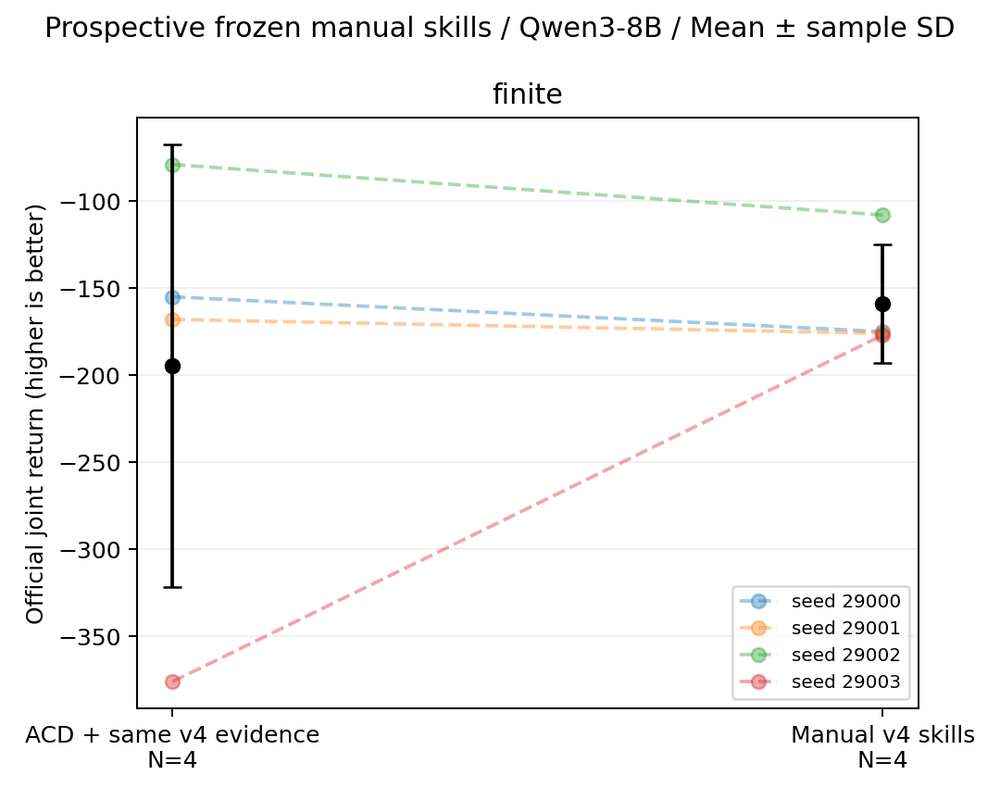

# v4 수동 Skill 보완의 전향적 평가

상태: completed. 같은 v4 사건·연결 이력과 Sleep 선택지를 공유한다. Qwen3-8B/Hybrid/500-step, Pool 동결.

수동 7개 초기 Skill과 관찰 기반 검증의 평가다. closed-loop 학습 Skill의 개선 수치로 합산하지 않는다.

| Red | 방식 | N | 평균 공동 보상 | 표본 SD | 시드별 보상 |
|---|---|---:|---:|---:|---|
| finite | E0 | 4 | -194.5 | 127.20718009085283 | {'29000': -155.0, '29001': -168.0, '29002': -79.0, '29003': -376.0} |
| finite | E3 | 4 | -159.0 | 34.009802508492555 | {'29000': -175.0, '29001': -176.0, '29002': -108.0, '29003': -177.0} |

| Red | 대응 N | E3−E0 평균 | 개선 시드 | 시드별 차이 | 사전 기준 통과 |
|---|---:|---:|---:|---|---|
| finite | 4 | 35.5 | 1 | [-20.0, -8.0, -29.0, 199.0] | False |

사전 기준은 평균 차이 양수·4개 시드 중 3개 이상 개선이다. FiniteState에서 통과하지 않으면 AggressiveFSM은 사전 조건으로 미실시한다. 미실시를 0점이나 성공으로 표시하지 않는다.
전이 평가 상태: not_run_finite_criterion_failed. N=4의 표본 SD는 신뢰구간이 아니다. 오류 분석에 사용한 시드 24001을 최종 표본으로 재사용하지 않는다.

오류 분석 시드 24001, 새 평가 29000–29003, 조건부 전이 30000–30003을 고정 프로토콜로 구분한다. 기존 개발 태그를 새 평가 설정에서 제거했으며 어느 평가도 Pool을 학습시키지 않는다.
미완료 표의 조건별 N이 다르면 평균 차이를 최종 대응 효과로 해석하지 않는다.

## 기록된 궤적의 원본 보상 분해

모든 Blue의 관측·행동·보상이 원본과 일치한 재생만 집계했다. 입력 summary와 trace의 hash도 확인했다. 새 성능 표본이나 단일 행동의 인과 분석이 아니다.

| Red | 방식 | N | 팀 행동 비용 | Red Impact | 로컬 작업 실패 | 서비스 접근 실패 | 합계 |
|---|---|---:|---:|---:|---:|---:|---:|
| finite | E0 | 4 | -61 | -72.5 | -26.5 | -34.5 | -194.5 |
| finite | E3 | 4 | -68 | -78 | -13 | 0 | -159.0 |

