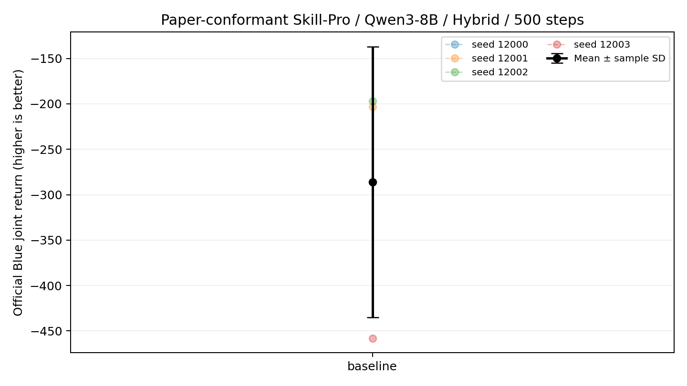

# 수정 후 실제 Qwen 성능

상태: partial. 500-step / Hybrid / 동일 Qwen3-8B / seeds [12000, 12001, 12002, 12003].

| 방식 | N | 평균 보상 | 표본 SD | seed별 보상 |
|---|---:|---:|---:|---|
| baseline | 3 | -286.0 | 148.98657657654934 | {'12001': -203.0, '12002': -197.0, '12003': -458.0} |
| static_verified | 0 | None | None | {} |
| loop1 | 0 | None | None | {} |
| loop2 | 0 | None | None | {} |
| transfer_baseline | 0 | None | None | {} |
| transfer_loop2 | 0 | None | None | {} |

| Loop | 훈련 보상 | 훈련 평균 | 검증 보상 | 방문 Parent | 승인 Skill | Pool |
|---|---|---:|---:|---:|---|---:|

학습 전후 Skill 효과는 loop1/loop2와 static_verified의 대응 seed 차이로 판단한다.
공통 행동 인터페이스가 바뀌었으므로, 과거 다른 seed의 표와 차이를 계산해 학습 효과라고 해석하지 않는다.
N=4의 관측된 평균 차이는 광범위한 통계적 우위의 증명이 아니다.

