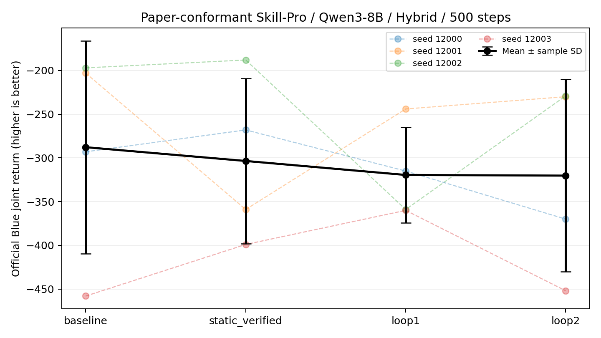
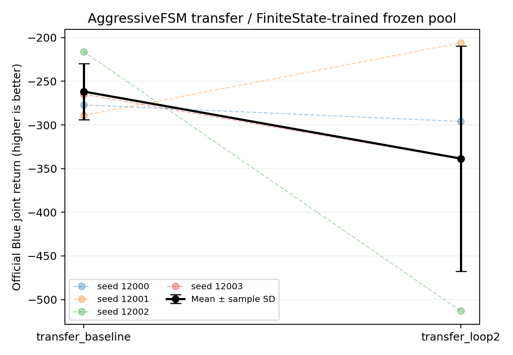

# 수정 후 실제 Qwen 성능

상태: completed. 500-step / Hybrid / 동일 Qwen3-8B / seeds [12000, 12001, 12002, 12003].

| 방식 | N | 평균 보상 | 표본 SD | seed별 보상 |
|---|---:|---:|---:|---|
| baseline | 4 | -287.75 | 121.69737055499597 | {'12000': -293.0, '12001': -203.0, '12002': -197.0, '12003': -458.0} |
| static_verified | 4 | -303.5 | 94.51807587264283 | {'12000': -268.0, '12001': -359.0, '12002': -188.0, '12003': -399.0} |
| loop1 | 4 | -319.5 | 54.53133655676034 | {'12000': -315.0, '12001': -244.0, '12002': -359.0, '12003': -360.0} |
| loop2 | 4 | -320.25 | 110.00719673427432 | {'12000': -370.0, '12001': -230.0, '12002': -229.0, '12003': -452.0} |
| transfer_baseline | 4 | -261.75 | 32.035136959282696 | {'12000': -277.0, '12001': -289.0, '12002': -216.0, '12003': -265.0} |
| transfer_loop2 | 4 | -338.5 | 128.85780276464956 | {'12000': -296.0, '12001': -206.0, '12002': -513.0, '12003': -339.0} |

| Loop | 훈련 보상 | 훈련 평균 | 검증 보상 | 방문 Parent | 승인 Skill | Pool |
|---|---|---:|---:|---:|---|---:|
| 1 | [-399.0, -315.0] | -357.0 | -131.0 | 7 | ['ThreatRemoval_v2', 'HostRecovery_v2', 'TrafficRecovery_v2', 'WaitVerification_v2'] | 8 |
| 2 | [-271.0, -153.0] | -212.0 | -189.0 | 4 | ['DeceptionDeployment_v2', 'WaitVerification_v2_c0', 'ThreatRemoval_v3', 'WaitVerification_v3'] | 10 |

학습 전후 Skill 효과는 loop1/loop2와 static_verified의 대응 seed 차이로 판단한다.
공통 행동 인터페이스가 바뀌었으므로, 과거 다른 seed의 표와 차이를 계산해 학습 효과라고 해석하지 않는다.
N=4의 관측된 평균 차이는 광범위한 통계적 우위의 증명이 아니다.

